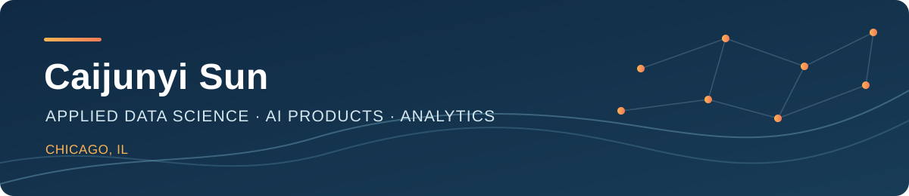

  

# Hi, I'm Caijunyi Sun 👋

I'm a Chicago-based applied data science graduate student with a background in economics, business analysis, and consulting. I enjoy turning messy data and emerging AI tools into clear, evidence-backed decisions.

I'm exploring **AI product management**, **data analytics**, and other **data science and applied AI** roles in Chicago and across the United States.

I'm especially interested in how **LLMs and AI agents** can be evaluated and shaped into products people use.

[LinkedIn](https://www.linkedin.com/in/caijunyisun/) · [GitHub](https://github.com/Joey-Suncai)

## What I've worked on

- **AI-assisted financial review:** Designed a 0–5 scoring rubric for reviewing MD&A disclosures with ChatGPT-assisted analysis, cited evidence, and senior analyst validation at Hyde Park Investment Services.
- **Financial analysis:** Cleaned public market data and built standardized forecast models for 14 companies.
- **Energy economics:** Built a levelized cost of fuel model comparing green and grey methanol under different carbon-price, feedstock, and capital-cost assumptions at Frost & Sullivan.

## Selected academic projects

- **Short-term stock return modeling:** Compared 10 statistical and machine learning models using daily observations from S&P 500 stocks, with a separate 2017–2018 holdout period. The work focused on careful benchmarking and the limits of predictability.
- **North Carolina tax reform analysis:** Used synthetic control with 42 donor states and placebo tests to study private fixed investment after the state's corporate tax reform. Implemented the analysis in R.

## Tools and methods

**Languages:** Python, R, SQL, Bash  
**Analysis:** pandas, NumPy, scikit-learn, Excel  
**Visualization:** Tableau, ggplot2  
**Methods:** forecasting, model comparison, synthetic control, Random Forest, KNN

## Education

- **University of Chicago** — M.S. in Applied Data Science, expected December 2027
- **University of Illinois Urbana-Champaign** — B.A. in Economics, May 2026
